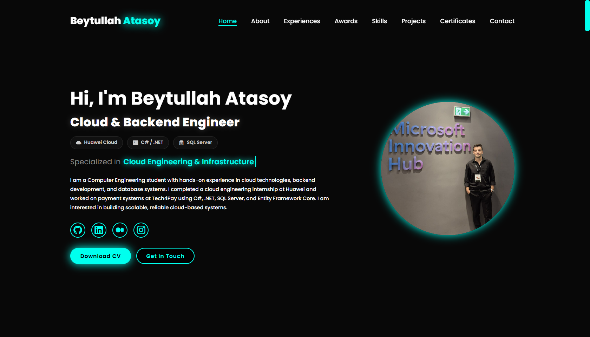
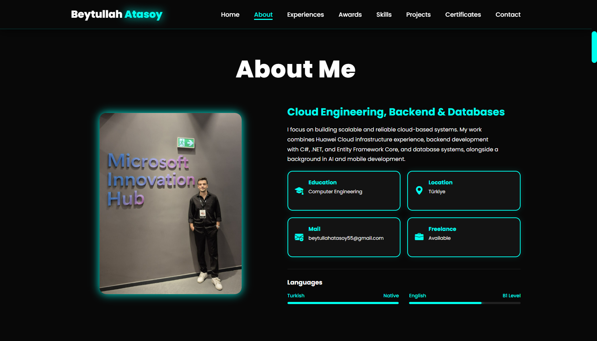

# Beytullah Atasoy | Personal Portfolio

My portfolio documents my work in cloud engineering, .NET backend development, and database systems. It includes an experience timeline, awards, skills, certificates, a downloadable CV, and a filterable project gallery.

The site uses HTML, CSS, and vanilla JavaScript. The contact form prepares an email draft for Gmail or Outlook.

## Featured projects

| Project | What it does |
| --- | --- |
| [EduVisionAI](https://github.com/beytullahatasoy/EduVisionAI1) | Mobile accessibility app using text-to-speech and Huawei Cloud. |
| [ReGreen](https://github.com/beytullahatasoy/ReGreen) | Uses geospatial data to assess post-wildfire recovery and prioritize field interventions. |
| [PaymentSystem](https://github.com/beytullahatasoy/PaymentSystem) | Layered ASP.NET Core payment backend with Entity Framework Core and SQL Server. In development. |
| [StockPriceAI](https://github.com/beytullahatasoy/StockPriceAI) | Compares LSTM and GRU models for financial markets and presents the results in Streamlit. |

## Screenshots

### Home



### About Me



## Run locally

```sh
git clone https://github.com/beytullahatasoy/my_portfolio.git
cd my_portfolio
```

Open `index.html` in a browser.
